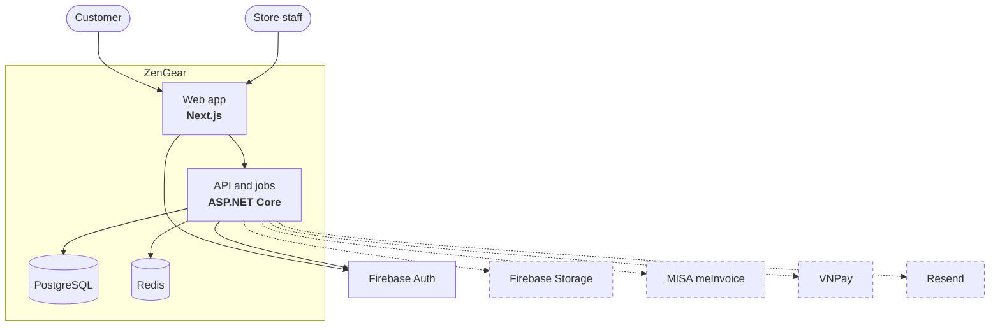
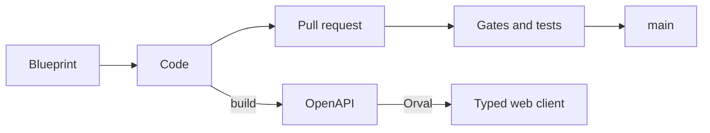

# ZenGear

**A retail system for a Vietnamese PC and hardware store** — counter sales, stock with serial numbers, purchasing,
warranty and e-invoices, then online sales. Built specification-first, with a typed contract between a .NET API and
a Next.js app.


**Status:** pre-release, not deployed. Phase 1 (in-store sales) is in progress.

<!-- Screenshots go here once available:
<p align="center">
  
  
</p>
-->

## The problem

A small PC store sells parts and custom-built PCs, buys from many suppliers, and owes each customer warranty on
every serial number. It also carries the VAT, e-invoice and bookkeeping duties of a Vietnamese household business
(hộ kinh doanh). Spreadsheets lose track of serials, stock value and warranty claims; ZenGear keeps them in one
system.

## What works today

- Staff accounts with roles and permissions: create, disable and restore, a staff list and a staff account page.
- Sign-in, the admin shell, my account and password change.
- The store's business location; brands and product series in the API.

Next: the catalog, prices and VAT, then purchasing and the stock ledger. The full scope by phase is in the
[roadmap](docs/blueprint/roadmap.md).

## Architecture





Dashed services are planned. The API has three layers (Api → Services → Data) kept apart by architecture tests.
Target hosting: Vercel for the web, Azure for the API and database. More in
[`docs/ARCHITECTURE.md`](docs/ARCHITECTURE.md) and the [decisions](docs/blueprint/decisions.md).

## Engineering highlights

- **Specification first** — features, business rules and 120+ decisions in a [blueprint](docs/blueprint/README.md);
  a CI gate refuses a feature whose rules have no test.
- **Typed contract** — the web client is generated from the API's OpenAPI document; CI fails on drift.
- **Real infrastructure in tests** — 700+ API tests, the integration ones on Testcontainers (PostgreSQL, Redis),
  plus Vitest, Postman and Playwright in CI.
- **Schema checked** — the schema built by EF Core migrations is compared in CI with a hand-written SQL specification.
- **Security** — Firebase sign-in, role permissions cached in Redis, a nonce-based CSP, Problem Details errors.
- **Accessibility** — WCAG 2.2 AA colour contrast measured by tests.

## How it was built

I wrote the specification and the decisions, designed and approved every screen, and reviewed and tested every
change before it merged. The implementation is AI-assisted (Claude Code), working under written rules
([`CLAUDE.md`](CLAUDE.md)), reviewer agents and the CI gates above.

## Trade-offs

- **Process before features.** The gates, reviews and decision records cost time up front; they pay off in a
  long-lived codebase where most code is written by an AI that must not drift from the specification.
- **Not deployed yet.** The pipeline builds the API image; deployment and observability come with the first release.

## What I learned

- **Writing decisions down makes changing course cheap.** When a real pull request disproved an assumption about
  the CI gates, the written plan showed exactly which part to drop, and the planned gate code was never written.
- **Measuring beats eyeballing.** Contrast tests caught colour pairs that looked fine but failed WCAG 2.2 AA.
- **A generated contract turns API changes into compile errors** instead of broken screens at runtime.
- **Small, regular upgrades beat one big catch-up** — letting versions drift turned one upgrade into six pull
  requests.

## Run it locally

Requires Docker Desktop, the .NET SDK of `api/global.json`, Node.js of `web/.nvmrc`, PowerShell 7, and Python 3 on
PATH as `python`. First set the user-secrets of `ZenGear.Api` listed in [`api/CLAUDE.md`](api/CLAUDE.md)
(*Local database*); the sign-in accounts are in [`docs/ACCEPTANCE.md`](docs/ACCEPTANCE.md).

```bash
pwsh -NoProfile -File tools/env_doctor.ps1          # checks the set-up, says what to fix
cd api && docker compose up -d postgres redis firebase && dotnet tool restore && cd ..
pwsh -NoProfile -File tools/dev_reset.ps1           # database, seed data, development accounts
dotnet run --project api/src/ZenGear.Api --launch-profile http
```

Then, in a second terminal from the repository root:

```bash
cd web && npm ci && npm run dev                     # http://localhost:3000/admin
```

## License

All rights reserved; third-party code (shadcn/ui, Vercel's Web Interface Guidelines) keeps its MIT license.
