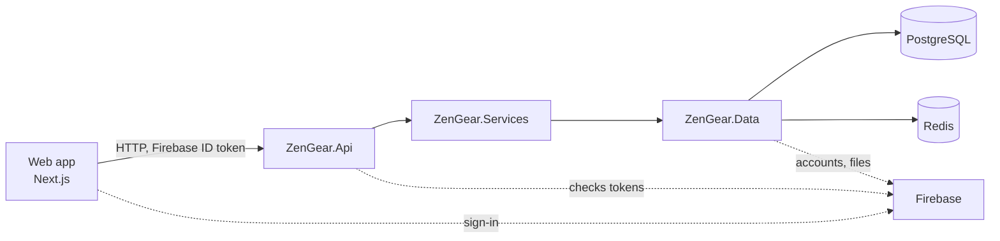

# ZenGear

Retail system for a PC and hardware store run as a Vietnamese household business (hộ kinh doanh): a storefront, an
admin, a point of sale, and the back office behind them — inventory ledger, purchasing, warranty and returns, cash
book and e-invoices.

**Status**: Phase 1 (in-store sales) is under way; the next work is in [`docs/STATUS.md`](docs/STATUS.md) and the
phases in the [roadmap](docs/blueprint/roadmap.md).

## Stack

| Part | Technology |
|---|---|
| Web — storefront, admin, POS | Next.js, React, TypeScript, Tailwind CSS, shadcn/ui, TanStack Query, next-intl |
| API client | Generated by Orval from the OpenAPI contract of the API (`api/openapi/ZenGear.Api.json`) |
| Backend API and jobs | .NET 10, ASP.NET Core, EF Core with Npgsql, FluentValidation, Serilog |
| Data | PostgreSQL 18, Redis (access cache) |
| Identity and files | Firebase Authentication, Firebase Storage |
| Tests | NUnit with Testcontainers, Vitest, Playwright, a Postman collection |
| Hosting | Vercel (web), Azure (API and database) |

Versions and the reason for each choice: [`docs/blueprint/tech-stack.md`](docs/blueprint/tech-stack.md).

The backend is a 3-layer solution (Presentation, Business Logic, Data Access); the web never hand-writes API types or
calls, and every business rule is enforced by the API. Details: [`docs/ARCHITECTURE.md`](docs/ARCHITECTURE.md) and
[`docs/FRONTEND.md`](docs/FRONTEND.md).

## Repository

| Folder | Content |
|---|---|
| `api/` | .NET backend, tests, the schema specification (`db/`), reference data (`seed/`), the OpenAPI contract (`openapi/`) |
| `web/` | Next.js app: storefront, admin and POS, with its Vitest tests and Playwright flows (`e2e/`) |
| `docs/` | Specifications shared by both: blueprint, architecture, database, API conventions, glossary, screens |
| `postman/` | The Postman collection, one folder per feature, and its environments |
| `tools/` | Blueprint export and patch, PR gates, schema comparison, feature dossier, environment check |

## Run it locally

Requirements: Docker Desktop, the .NET SDK of [`api/global.json`](api/global.json), Node.js of
[`web/.nvmrc`](web/.nvmrc), PowerShell 7, Python 3 and, for the API scenarios, the Postman CLI of
[`docs/ACCEPTANCE.md`](docs/ACCEPTANCE.md). `pwsh -NoProfile -File tools/env_doctor.ps1` checks the whole set-up
without changing anything and says what to fix; run it first and after each step.

1. Set the user-secrets of `ZenGear.Api` named in [`api/CLAUDE.md`](api/CLAUDE.md) (*Local database*).
2. Start PostgreSQL, Redis and the Firebase Auth Emulator: `docker compose up -d postgres redis firebase` in `api/`.
3. Restore the .NET tools once: `dotnet tool restore` in `api/`.
4. Build the database, the seed and the development accounts: `pwsh -NoProfile -File tools/dev_reset.ps1`.
5. Run the API: `dotnet run --project api/src/ZenGear.Api --launch-profile http` (http://localhost:5256).
6. Run the web: `npm ci`, then `npm run dev` in `web/`, and open http://localhost:3000/admin. The accounts to sign in
   with are in [`docs/ACCEPTANCE.md`](docs/ACCEPTANCE.md) (*Accounts*).

## Tests

| What | Command |
|---|---|
| API build and tests | `dotnet test api/ZenGear.slnx` (integration tests need Docker) |
| Web checks | `npm run lint`, `npm run format`, `npm run typecheck`, `npm run test` in `web/` |
| Screen flows | `npm run e2e` in `web/`, with the API and the emulator running; set-up in [`docs/ACCEPTANCE.md`](docs/ACCEPTANCE.md) (*Screen flows*) |
| API scenarios | `postman collection run postman/collections/ZenGear -e postman/environments/dev.environment.yaml --no-report-events` |
| Tooling | `python3 -m unittest discover -s tools/tests -v` |

CI runs these checks on the pull requests that touch their paths; `main` changes only through pull requests whose
required checks pass.

## How the work is done

- **Specification first.** What to build lives in the blueprint workbook, exported to
  [`docs/blueprint/`](docs/blueprint/README.md): features, use cases, business rules and the decisions (DEC-xxx)
  behind them. Code follows it; a change of design is a new decision.
- **Design before code.** Each screen is drawn and approved before it is built ([`docs/SCREENS.md`](docs/SCREENS.md)).
- **AI-assisted, human-approved.** Features are implemented with Claude Code under the rules of
  [`CLAUDE.md`](CLAUDE.md): tests first, reviewer agents, and CI gates that check rule coverage, decisions and
  commit identity. The owner tests every feature before it merges ([`docs/AUTOMATION.md`](docs/AUTOMATION.md)).
- **Commits** follow Conventional Commits; pull requests merge with *Rebase and merge*.

## Documentation

| Question | File |
|---|---|
| What the system does | [`docs/blueprint/`](docs/blueprint/README.md) |
| Business terms in code, database and UI | [`docs/GLOSSARY.md`](docs/GLOSSARY.md) |
| Tables, columns and constraints | [`docs/DATABASE.md`](docs/DATABASE.md) |
| Backend structure | [`docs/ARCHITECTURE.md`](docs/ARCHITECTURE.md) |
| HTTP API shape | [`docs/API_CONVENTIONS.md`](docs/API_CONVENTIONS.md) |
| Web structure | [`docs/FRONTEND.md`](docs/FRONTEND.md) |
| How backend code is written and judged | [`docs/CODING_GUIDE.md`](docs/CODING_GUIDE.md) |
| Testing a feature on the development environment | [`docs/ACCEPTANCE.md`](docs/ACCEPTANCE.md) |
| Rules for every change | [`CLAUDE.md`](CLAUDE.md), [`api/CLAUDE.md`](api/CLAUDE.md), [`web/CLAUDE.md`](web/CLAUDE.md) |

## License

No license file: all rights reserved, except third-party code under its own license: the shadcn/ui components in
`web/src/components/ui/` (MIT, shadcn-ui/ui), and Vercel's Web Interface Guidelines and the shadcn skill in `.claude/`
(MIT, with their license files beside them).
